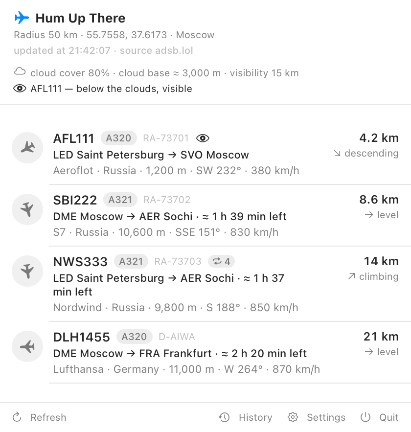

# Hum Up There ✈️

[](https://github.com/Tatarovich/humupthere/actions/workflows/build.yml)
[](LICENSE)


🌐 **English** · [Русский](README.ru.md)

**Hum Up There** is a macOS menu bar app that shows which aircraft are flying over your
location right now — and where they are going. It uses open ADS-B data.

The name is about that hum above your head: you hear it, open the popover, and see who it was.

**Website:** <https://humupthere.ru/>



## ✨ What it does

### 🛰 Menu bar

- **Live status next to the clock** — the nearest callsign and distance, the number of aircraft,
  or just the icon.
- **Custom app icon** — visible in Finder, Login Items and the app list.
- **Course-aware icons** — north is up, south is down, west is left. Turn rotation off and every
  icon points up, like the app icon.

### ✈️ Flights

- **From and to** — `SVO Moscow → HAN Hanoi`: the airport IATA code and the full city name.
- **Time to landing** — for cruising aircraft only: `≈ 3 h 13 min left`.
- **Airline and country** — `Scandinavian · Sweden` right in the row. Show the country as a name,
  a two-letter code, or not at all. Hover for the full airline name, IATA/ICAO codes and country.
- **Altitude filter** — keep only aircraft below 1, 3 or 5 km. Alerts follow the same filter.
- **Ground traffic** — show or hide aircraft on the ground.

### 🔔 Alerts

- **New aircraft in the radius** — a system notification with the selected sound. If notifications
  are not allowed, a corner card with the same sound. The card shows type, registration, route
  and ETA, airline and country, altitude, heading and speed.
- **Two alert sounds** — a short airport announcement (default) or a low aircraft hum. Both are
  trimmed and intentionally quiet.

### 🌤 Visibility

- **See it or just hear it** — the app checks the weather at your point (Open-Meteo, no key) and
  uses cloud cover, estimated cloud base and visibility to tell whether you can see the aircraft
  or only hear it. Visible flights get an eye marker. Can be disabled.
- **Weather in the popover** — cloud cover, cloud base estimate and visibility at a glance.

### 📊 Data and history

- **Personal OpenSky keys** — register yourself and enter your own clientId and clientSecret.
  With keys, OpenSky becomes the primary source and the daily limit grows from 400 to 4,000
  credits. Keys live in a separate owner-only file.
- **Familiar aircraft** — every aircraft is remembered by code, and repeat visitors get a sighting
  counter. Unlike history, this list never expires. You can disable it or forget everything.
- **Flight history** — a separate window with everything that passed overhead in the last three
  days: time, aircraft, type, airline, route, closest distance and altitude. Older entries are
  removed automatically; there is a Clear button.

### 🪟 Comfort and system

- **Calm look** — no colored accents: the aircraft icon is gray on gray, routes are emphasized
  with weight rather than color. Long lines wrap instead of being cut with an ellipsis.
- **Two UI languages** — Russian and English switch on the fly, no restart. City names are
  localized as well.
- **A normal settings window** — open the browser for coordinates, come back, and the window is
  still there.
- **Launch at login** — a checkbox in settings, backed by the system `SMAppService`. The app
  appears in macOS Login Items.
- **Settings** — observation point (manual or by IP), radius **10 / 20 / 50 / 100 km**, refresh
  interval, menu bar style, ground aircraft.

## 🧭 Requirements

- macOS 15 or later.
- Swift 6 toolchain — Command Line Tools are enough, full Xcode is not required.

## 🚀 Build and install

Ready-to-download builds will appear on <https://humupthere.ru/>. To build from source:

```bash
git clone https://github.com/Tatarovich/humupthere.git
cd humupthere
./build.sh                                  # build release, package dist/HumUpThere.app
cp -R dist/HumUpThere.app /Applications/    # install into /Applications
open /Applications/HumUpThere.app           # launch
```

Installing into `/Applications` matters: launch at login and system notifications are more
reliable when the app does not move with the project folder.

Icons and sounds can be rebuilt separately:

```bash
./tools/make_icon.sh            # needs Python 3 with Pillow and numpy
python3 tools/make_sound.py
```

Install the Python dependencies with `python3 -m pip install pillow numpy`.

## 🧪 Command-line checks

```bash
APP=/Applications/HumUpThere.app/Contents/MacOS/HumUpThere

"$APP" --diagnose                  # coordinates, source, nearest aircraft, routes, weather
"$APP" --test-detection            # test the “new aircraft” logic
"$APP" --test-opensky              # test OpenSky keys: token, request, credits
"$APP" --test-familiar             # test the familiar aircraft registry
"$APP" --render-row-samples /tmp/s.png   # row samples with “visible” and “familiar” markers
"$APP" --render-alert /tmp/a.png   # render the alert card to PNG
"$APP" --render-rows /tmp/r.png --at 51.5074 -0.1278   # rows at another point, settings untouched
"$APP" --render-marketing /tmp/shots   # site screenshots: popover, card, rows (RU/EN)
"$APP" --test-alert                # test the alert channel (card visible for 7 seconds)
"$APP" --login-item on             # enable launch at login (off — disable)

# Aircraft list with routes right in the terminal
swift run humupthere-cli --lat 55.755864 --lon 37.617698 --radius 100
swift run humupthere-cli --lat 51.5074 --lon -0.1278 --radius 60 --max-altitude 3000
```

## 📡 Data sources

| Source | Role | Notes |
|---|---|---|
| [adsb.lol](https://adsb.lol) | aircraft, primary | circle “point + radius”, distance and bearing included, no key needed |
| [OpenSky Network](https://opensky-network.org) | aircraft, primary with personal keys | rectangle only; 400 credits/day anonymously, 4,000 with free keys, 8,000 for feeders. Uses multilateration across receivers, so it sees more than volunteer-only networks |
| [adsbdb](https://adsbdb.com) | flight routes | by callsign returns departure and arrival airports; 30-day cache |
| [Open-Meteo](https://open-meteo.com) | weather and visibility | free, no key; snapshot kept for 15 minutes |
| [Wikidata](https://www.wikidata.org) | city names | Russian and English city names, embedded in the app |

Rejected: `airplanes.live` (403), `adsb.one` (Cloudflare), `adsb.fi` (400),
`api.adsb.lol/api/0/routeset` (empty response).

## ⚙️ How it works

### New aircraft detection

An aircraft is considered new only if it has not been in the radius during the last 30 minutes
(`AircraftVisitTracker`). Comparing only with the previous snapshot would produce false alerts:
an aircraft on the edge of the radius can disappear on one poll and reappear on the next. The
first snapshot after launch is only remembered — otherwise you would get a notification about
the whole list. At most three aircraft per refresh. The channel is chosen automatically: a system
notification if allowed, otherwise the corner card with sound. Test it with `--test-detection`.

### Source order

Without keys, adsb.lol is asked first and OpenSky is the fallback. Once you enter your OpenSky
keys, OpenSky becomes primary: outside Europe it sees noticeably more aircraft (11–14 over
Moscow, where adsb.lol returns 1–2), and personal keys raise the daily limit from 400 to 4,000
credits. A two-minute poll costs about 720 credits per day — plenty of headroom.

### Replacing keys

The OpenSky section has Check, Replace keys and Delete keys. Replace shows input fields over the
connected keys: the old pair keeps working until Save and check; Cancel restores everything.
Empty fields just ask you to fill them in and leave the file untouched.

### Credits and cooldowns

OpenSky reports the remaining credits in the response header, and on 429 it says how many seconds
to wait. The app remembers both: settings show the remaining credits, and after the limit is
exhausted the source is not called until the specified time.

### History

Everything the source saw is written, regardless of the altitude filter: this is a log of what
was actually overhead, while the filter is a display setting. The same aircraft flying twice
produces two entries. Routes are filled from the cache when the window opens — no network needed.

### Visibility

Open sources do not provide a ready cloud base (the field arrives empty), so it is estimated with
the rule of 125 m per degree of temperature–dewpoint spread. Then it is simple: cloud cover up to
25% — visible; up to 60% — visible in gaps; overcast — visible only below the clouds; visibility
under 2 km — no sky at all; at night only lights, and only nearby. Weather does not depend on the
aircraft source, so it is requested even when that source is rate-limited.

### Familiar aircraft

The registry is keyed by aircraft code, lives in `familiar.json` and never expires: entries older
than two years are removed, up to 20,000 total. A new visit is a return after more than 30
minutes, just like history. Test it with `--test-familiar`.

### Time to landing

Calculated only for cruising aircraft (ground speed from 500 km/h): the straight-line distance to
the destination airport divided by current speed. There is no estimate for takeoff and approach —
at low speed it becomes fantasy like “Moscow to Vladivostok in 19 hours”.

### Altitude filter

Aircraft with unknown altitude are kept: better to show than to lose. The filter also affects
alerts — they are built from the same filtered list.

### Airline country

Taken from the airline, not the aircraft: for a flight, the operator matters more. There are
deliberately no flag emoji — at small sizes they turn into a colorful rectangle and make the row
noisy. The comparison is in `docs/country-styles.png` (Russian UI). Airline names are shortened:
“Scandinavian Airlines System” → “Scandinavian”, “Swiss International Air Lines” → “Swiss”, but
“British Airways” is left alone — “Airways” is part of the name, not a suffix. Data comes from
adsbdb together with the route; no route (private, military, cargo) means no country.

### Icon

The artwork is delivered as a `.icns` filling a 1024×1024 square: macOS 26 draws the margins and
rounded corners itself. If you draw them in advance, the system frames them again and the icon
looks nested in a gray border (verified by comparison). For macOS 15 and earlier there is a
`--rounded` flag that adds margins and rounding to the file.

### Launch at login

`SMAppService.mainApp` — the system mechanism from macOS 13+, not a hand-made LaunchAgent in
`~/Library/LaunchAgents`.

## ⚠️ Limitations

- Aircraft are visible only where a ground ADS-B receiver picks them up. Over Moscow, community
  coverage is much sparser than over Europe: in a 100 km radius you usually see a few aircraft,
  while over London there are dozens. This is a property of the sources, not the app.
- Not every flight has a route: charters, cargo, military and private aircraft are often missing
  from the directory — such a row is simply not shown.
- System notifications need a one-time permission. If macOS does not show the prompt, the fallback
  channel works — the corner card with sound.
- Coordinates in public feeds lag by seconds, and some aircraft never appear in them.
- **Coverage depends on receivers, not on the source.** Volunteer networks (adsb.lol, adsb.fi)
  only see where volunteers live with receivers, so over the Urals their coverage is almost zero:
  zero aircraft over Perm airport and Yekaterinburg, three over the whole 600 km area around
  Solikamsk. OpenSky adds multilateration, but it also needs receivers nearby. Changing the source
  does not close this gap: only your own receiver helps (RTL-SDR plus a 1090 MHz antenna). With
  personal OpenSky keys the daily limit is 4,000 credits.
- Cloud base is an estimate from temperature and dewpoint, not a measurement: the source does not
  provide a ready field. Visibility is approximate too: it describes weather at the ground, not
  what you personally see from your window.
- Sources rate-limit requests: during active checks adsb.lol answers `429 Too Many Requests`. The
  app does not retry immediately; it waits for the next cycle and shows a clear explanation
  instead of raw HTML.
- The app is not a substitute for air traffic control services.

## 📁 Project layout

<details>
<summary>Show the file tree</summary>

```text
.github/workflows/build.yml  GitHub Actions build
Package.swift
LICENSE
README.md                    English description
README.ru.md                 Russian description
Sources/
  HumUpThereCore/           logic without UI
    Geo.swift               distances, bearings, units and language-aware formatting
    Aircraft.swift          aircraft model and remaining-flight calculation
    Route.swift             airport, route, adsbdb client and route cache
    Weather.swift           Open-Meteo weather and the “can you see it” estimate
    AircraftVisitTracker.swift  memory of recently seen aircraft
    CountryNames.swift      country names ru/en (generated from Wikidata)
    AirportNames.swift      city directory ru/en from Wikidata (generated)
    ADSBClient.swift        adsb.lol and OpenSky client, source order
    OpenSkyCredentials.swift  personal OpenSky keys with 600 permissions
    OpenSkyAuth.swift       OAuth2: 30-minute token, refresh, pause after 429
  HumUpThere/               menu bar app
    HumUpThereApp.swift     entry point, MenuBarExtra, settings window, diagnostics
    AppConfig.swift         settings, language, popover style
    Localization.swift      all interface strings in two languages
    RadarViewModel.swift    polling, routes, new aircraft detection
    RadarView.swift         popover: header and aircraft list
    AircraftText.swift      shared aircraft formatting for list and alert card
    AppLinks.swift          external app links (website)
    SettingsView.swift      settings window
    Notifications.swift     system notifications
    AircraftAlert.swift     channel selection and corner card
    History.swift           flight history: model and 3-day store
    HistoryView.swift       history window with a table
    Familiar.swift          familiar aircraft registry with sighting counter
    LaunchAtLogin.swift     launch at login via SMAppService
  humupthere-cli/           terminal source checks
Resources/
  Info.plist
  HumUpThere.icns           app icon
  airport.aiff              “airport announcement” sound: 1.4 s, 9.7× quieter than the source
  hum.aiff                  fallback sound: low hum
tools/
  make_icon.sh              wrapper around make_icon.py
  make_icon.py              build .icns from icon_hum.png
  make_sound.py             synthesize the “hum” sound
  make_alert_sound.py       trim and quiet the alert sound
  make_country_names.py     country names directory from Wikidata
docs/                        UI screenshots (Russian and English)
icon_hum.png                 source icon artwork
Draw_blue_airplane_icon_2K_20261013085601.jpg  the same artwork in 2K, original
signal-before-the-announcement-at-the-airport-version-2.mp3  original alert recording
build.sh
```

</details>

## 🗺️ Roadmap

- Merge adsb.lol and OpenSky responses into one list instead of choosing sources in turn.
- Add adsb.fi as a third source: its response format is the same as adsb.lol.
- Filter by airline or aircraft type.
- Fill the gaps in the city directory: for some airports Wikidata has no Russian name, so the
  English one is shown.

## 🙏 Made with DeepSeek

The app code, the copy, the interface rendering and the website were built together with
[DeepSeek](https://www.deepseek.com/). It did not “generate the project”; it helped us think:
untangled logic, suggested solutions, caught mistakes and explained why something was not working.
For a small project without a team, that mattered more than any ready-made template: there was
always someone to talk to who knows Swift, CSS — and how to disagree.

> Thank you, DeepSeek — and the people who built it — for patience with endless edits, for speed,
> and for an honest “this should be rewritten”. Without you, neither this app nor this site
> would exist.
>
> — Vladimir Tatarovich, creator

## 💛 Support the project

The app is free, with no ads or subscriptions. Donations are the project’s fuel: the domain,
builds, coffee and late nights at the radar. They do not unlock paid features.

**Card transfer · RUB** — card to card:

```text
5536 9140 3935 1840
```

**Crypto · 4 networks**

| Network | Address |
|---|---|
| USDT · TRC-20 | `TTMmuG68drdKfthzBo4t9rY5n8QCFe917n` |
| TON | `UQCI5KdNl1xOzpOnepB6eho-2SzTEoNd3VKUT1XkLCoFnOzm` |
| SOL · Solana | `9Ud1NujZTQTsANo5hK97AZVTbWrdkP3NnypGRjDkCLgK` |
| ETH · Ethereum | `0x0Cb745cBb0f86ec2D5F6E1F280Df6E383A7B4f5A` |

Rubles — card only. USDT, TON, SOL and ETH each work only on their own network; funds sent on
the wrong network are lost forever. The author is self-employed and pays tax on these payments.

Donations go to the creator — **Vladimir Tatarovich**.

## 📄 License

The code is released under the MIT License — see [LICENSE](LICENSE). Data belongs to the sources
listed in “Data sources”; the app is not affiliated with those services.
