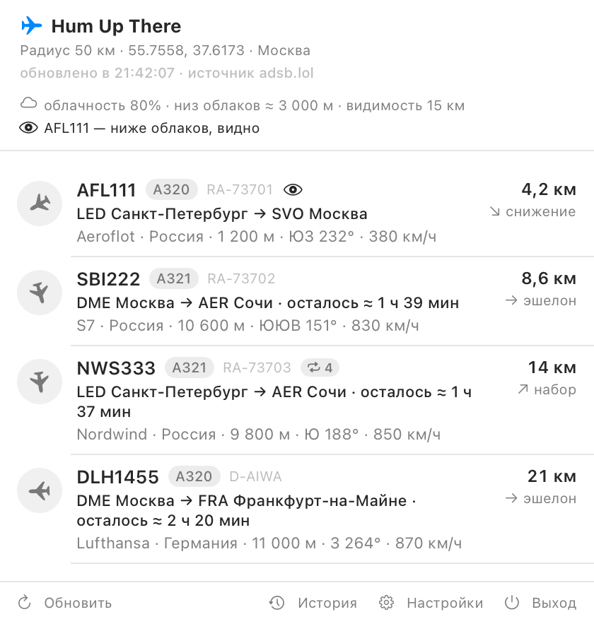

# Hum Up There ✈️

[](https://github.com/Tatarovich/humupthere/actions/workflows/build.yml)
[](LICENSE)


🌐 [English](README.md) · **Русский**

**Hum Up There** — приложение для macOS в строке меню. Показывает, кто из самолётов прямо
сейчас летит над вашей точкой, и куда он летит. Данные — из открытых источников ADS-B.

Название — про тот самый гул над головой: услышал — открыл — увидел, кто это был.

**Сайт:** <https://humupthere.ru/>



## ✨ Что умеет

### 🛰 Строка меню

- **Живой статус рядом с часами** — позывной ближайшего борта и дистанция до него, число
  бортов или только иконка.
- **Своя иконка приложения** — видна в Finder, в «Объектах входа» и в списке приложений.
- **Иконки по курсу** — летит на север, нос вверх; на юг — вниз; на запад — влево. Поворот
  можно отключить, тогда все иконки смотрят вверх, как на иконке приложения.

### ✈️ Полёты

- **Откуда и куда** — `SVO Москва → HAN Ханой`: трёхбуквенный код аэропорта (IATA) и полное
  название города.
- **Время до посадки** — только для крейсерского режима: `осталось ≈ 3 ч 13 мин`.
- **Авиакомпания и страна** — `Scandinavian · Швеция` прямо в строке борта. Страну можно
  показывать названием, двухбуквенным кодом или не показывать вовсе. Во всплывающей подсказке —
  полное название авиакомпании, коды IATA/ICAO и страна.
- **Фильтр по высоте** — оставить только борта ниже 1, 3 или 5 км. Оповещения используют тот же
  фильтр.
- **Борта на земле** — показывать или скрывать.

### 🔔 Оповещения

- **Новый борт в радиусе** — системное уведомление с выбранным звуком. Если уведомления не
  разрешены — карточка в углу экрана с тем же звуком. В карточке тип и регистрация борта,
  маршрут с городами и оценкой времени до посадки, авиакомпания со страной, высота, курс и
  скорость.
- **Два звука на выбор** — короткое «объявление в аэропорту» (по умолчанию) или низкий гул
  самолёта. Оба обрезаны и специально сделаны тихими.

### 🌤 Видимость

- **Видно или только слышно** — приложение спрашивает погоду в вашей точке (Open-Meteo, без
  ключа) и по облачности, оценке низа облаков и видимости говорит, увидите вы борт глазами или
  только услышите. У видимых бортов появляется маркер-глаз. Функцию можно выключить.
- **Погода в поповере** — облачность, оценка низа облаков и видимость одним взглядом.

### 📊 Данные и история

- **Личные ключи OpenSky** — каждый регистрируется сам и вводит свои clientId и clientSecret.
  С ключами OpenSky становится основным источником, а суточный лимит растёт с 400 до 4 000
  кредитов. Ключи лежат в отдельном файле с доступом только владельцу.
- **Знакомые борта** — приложение запоминает каждый борт по коду и считает встречи: у повторных
  появляется счётчик. В отличие от истории, этот список не истекает. Можно выключить или забыть
  всё.
- **История пролётов** — отдельное окно с таблицей: что пролетало над вами за последние три дня.
  Время, борт, тип, авиакомпания, маршрут, ближайшая дистанция и высота. Записи старше трёх дней
  удаляются сами, есть кнопка «Очистить».

### 🪟 Удобство и система

- **Спокойный вид** — без цветных акцентов: иконка борта серая на сером, маршрут набран
  насыщенностью, а не цветом. Длинный текст переносится на вторую строку, а не обрезается
  многоточием.
- **Два языка интерфейса** — русский и английский переключаются на лету, без перезапуска.
  Названия городов тоже переводятся: `Москва` / `Moscow`, `Ханой` / `Hanoi`.
- **Обычное окно настроек** — можно уйти в браузер за координатами и вернуться, окно останется.
- **Автозапуск** — галочка в настройках, через системный механизм `SMAppService`. Приложение
  появляется в «Объектах входа» macOS.
- **Настройки** — точка наблюдения (вручную или по IP), радиус **10 / 20 / 50 / 100 км**,
  интервал опроса, вид строки меню, борта на земле.

## 🧭 Требования

- macOS 15 или новее.
- Swift 6 toolchain — достаточно Command Line Tools, полноценный Xcode не нужен.

## 🚀 Скачать, собрать и установить

**Скачать:** [HumUpThere-0.1.0-macos-universal.zip](https://github.com/Tatarovich/humupthere/releases/download/v0.1.0/HumUpThere-0.1.0-macos-universal.zip) — универсальная сборка для macOS 15+ (Apple Silicon и Intel).

Распакуйте, перетащите `HumUpThere.app` в `/Applications` и запустите. Иконки в Dock не будет — ищите самолётик в строке меню.

> **Первый запуск:** сборка подписана ad-hoc и не нотаризована. macOS может её заблокировать: правый клик по приложению → **«Открыть»**, либо разрешите в **«Системных настройках» → «Конфиденциальность и безопасность»**.

Собрать из исходников:

```bash
git clone https://github.com/Tatarovich/humupthere.git
cd humupthere
./build.sh                                  # релиз и упаковка dist/HumUpThere.app
cp -R dist/HumUpThere.app /Applications/    # установка в /Applications
open /Applications/HumUpThere.app           # запуск
```

Установка именно в `/Applications` важна: автозапуск и системные уведомления работают надёжнее,
когда приложение не переезжает вместе с папкой проекта.

Иконка и звуки пересобираются отдельно:

```bash
./tools/make_icon.sh            # нужен Python 3 с Pillow и numpy
python3 tools/make_sound.py
```

Зависимости ставятся так: `python3 -m pip install pillow numpy`.

## 🧪 Проверка без интерфейса

```bash
APP=/Applications/HumUpThere.app/Contents/MacOS/HumUpThere

"$APP" --diagnose                  # координаты, источник, ближайший борт, маршруты, погода
"$APP" --test-detection            # проверка логики «новых бортов»
"$APP" --test-opensky              # проверка ключей OpenSky: токен, запрос, кредиты
"$APP" --test-familiar             # проверка реестра знакомых бортов
"$APP" --render-row-samples /tmp/s.png   # образцы строк с маркерами «видно» и «знакомый»
"$APP" --render-alert /tmp/a.png   # отрисовать карточку оповещения в PNG
"$APP" --render-rows /tmp/r.png --at 51.5074 -0.1278   # строки по чужой точке, настройки не трогаем
"$APP" --render-marketing /tmp/shots   # скриншоты для сайта: поповер, карточка, строки (RU/EN)
"$APP" --test-alert                # проверить канал оповещения (карточка видна 7 секунд)
"$APP" --login-item on             # включить автозапуск (off — выключить)

# Список бортов с маршрутами прямо в терминале
swift run humupthere-cli --lat 55.755864 --lon 37.617698 --radius 100
swift run humupthere-cli --lat 51.5074 --lon -0.1278 --radius 60 --max-altitude 3000
```

## 📡 Источники данных

| Источник | Роль | Особенности |
|---|---|---|
| [adsb.lol](https://adsb.lol) | борта, основной | окружность «точка + радиус», сразу с дистанцией и пеленгом, ключ не нужен |
| [OpenSky Network](https://opensky-network.org) | борта, основной с личными ключами | только прямоугольник; анонимно 400 кредитов в сутки, с бесплатными ключами 4 000, кормящим 8 000. Умеет определять борт по нескольким приёмникам, поэтому видит больше волонтёрских сетей |
| [adsbdb](https://adsbdb.com) | маршруты рейсов | по позывному отдаёт аэропорты вылета и назначения; кэш на 30 дней |
| [Open-Meteo](https://open-meteo.com) | погода и видимость | бесплатно, без ключа; снимок держится 15 минут |
| [Wikidata](https://www.wikidata.org) | названия городов | русские и английские названия, вшиты в приложение |

Отбракованы: `airplanes.live` (403), `adsb.one` (Cloudflare), `adsb.fi` (400),
`api.adsb.lol/api/0/routeset` (пустой ответ).

## ⚙️ Как это устроено внутри

### Новый борт

Борт считается новым, только если его не было в радиусе последние 30 минут
(`AircraftVisitTracker`). Сравнивать с одним предыдущим снимком нельзя: борт на краю радиуса
на одном опросе пропадает, а на следующем появляется снова — получалось бы ложное уведомление.
Первый снимок после запуска только запоминается, иначе прилетело бы сообщение про весь список.
Не больше трёх бортов за обновление. Канал выбирается сам: системное уведомление, если оно
разрешено, иначе карточка со звуком. Проверить: `--test-detection`.

### Порядок источников

Без ключей первым спрашивается adsb.lol, OpenSky — запасной. Как только пользователь вводит свои
ключи OpenSky, основным становится OpenSky: за пределами Европы он видит заметно больше (над
Москвой 11–14 бортов там, где adsb.lol отдаёт 1–2), а личные ключи поднимают суточный лимит с
400 до 4 000 кредитов. Опрос раз в две минуты — около 720 кредитов в сутки, с большим запасом.

### Замена ключей

В секции «Данные OpenSky» есть кнопки «Проверить», «Заменить ключи» и «Удалить ключи». Замена
показывает поля ввода поверх уже подключённых ключей: до нажатия «Сохранить и проверить»
продолжает работать старая пара, а «Отмена» возвращает всё как было. Пустые поля просто попросят
их заполнить и файл не тронут.

### Кредиты и паузы

OpenSky сообщает остаток кредитов в заголовке ответа, а при 429 — сколько секунд подождать.
Приложение это запоминает: в настройках видно остаток, а после исчерпания лимита источник не
дёргается до указанного срока.

### История

Пишется всё, что видел источник, независимо от фильтра по высоте: это журнал того, что
действительно было над головой, а фильтр — настройка отображения. Один и тот же борт,
пролетевший дважды, даёт две записи. Маршруты подставляются из кэша при открытии окна — сеть для
этого не нужна.

### Видимость

Готовой высоты облаков открытый источник не отдаёт (поле приходит пустым), поэтому низ облаков
оценивается по правилу «125 метров на градус» разницы между температурой и точкой росы. Дальше
просто: облачность до 25% — видно; до 60% — видно в просветах; при сплошной облачности борт
виден только если он ниже облаков; при видимости меньше 2 км неба не видно вовсе; ночью видны
только огни и только вблизи. Погода не зависит от источника бортов, поэтому спрашивается даже
когда тот ограничил частоту.

### Знакомые борта

Реестр по коду борта, живёт в `familiar.json` и не истекает: записи старше двух лет убираются,
всего до 20 000. Новый визит — возвращение позже чем через 30 минут, ровно как в истории.
Проверить: `--test-familiar`.

### Время до посадки

Считается только для бортов в крейсерском режиме (путевая скорость от 500 км/ч): расстояние по
прямой до аэропорта назначения делится на текущую скорость. Для взлетающих и заходящих оценка не
показывается — на малой скорости она превращается в фантастику вроде «Москва — Владивосток за
19 часов».

### Фильтр по высоте

Борта с неизвестной высотой не выбрасываются: лучше показать, чем потерять. Фильтр влияет и на
оповещения — они строятся по тому же отфильтрованному списку.

### Страна авиакомпании

Берётся у авиакомпании, а не у борта: для рейса важнее, кто его выполняет. Флага-эмодзи в
приложении нет намеренно — в мелком кегле он превращается в пёстрый прямоугольник, и строка от
него рябит; сравнение вариантов есть в `docs/country-styles.png`. Общий вид: `docs/popover-ru.png`
(поповер с погодой и видимостью), `docs/rows.png` (строки списка с маршрутами),
`docs/row-samples.png` (маркеры «видно» и «знакомый борт»). Картинки перерисовываются командами
`--render-popover`, `--render-rows` и `--render-row-samples`. Снимок поповера для README и сайта
делает `--render-marketing <папка>`: он рисует поповер, карточку и строки в RU/EN с
демонстрационными данными, не трогая настройки пользователя. Названия авиакомпаний сокращаются:
«Scandinavian Airlines System» → «Scandinavian», «Swiss International Air Lines» → «Swiss», но
«British Airways» не трогается — «Airways» здесь часть названия, а не суффикс. Данные приходят из
adsbdb вместе с маршрутом; где маршрута нет (частные, военные, грузовые борта), нет и страны.

### Иконка

Рисунок отдаётся в `.icns` во весь квадрат 1024×1024: поля и скругления дорисовывает сама
macOS 26. Если нарисовать их заранее, система обрамит их повторно, и иконка будет выглядеть
вложенной в серую рамку (проверено сравнением). Для macOS 15 и раньше есть флаг `--rounded`,
который делает поля и скругления в самом файле.

### Автозапуск

`SMAppService.mainApp` — системный механизм macOS 13+, а не самодельный LaunchAgent в
`~/Library/LaunchAgents`.

## ⚠️ Ограничения

- Борт виден только там, где его принимает наземный ADS-B приёмник. Над Москвой покрытие
  сообщества заметно реже, чем над Европой: в радиусе 100 км это обычно единицы бортов, тогда
  как над Лондоном — десятки. Это особенность источников, а не приложения.
- Маршрут есть не у всех: у чартеров, грузовых, военных и частных бортов его в справочнике нет —
  такая строка просто не показывается.
- Системные уведомления требуют однократного разрешения. Если macOS не показывает запрос,
  работает запасной канал — карточка со звуком.
- Координаты в открытых фидах запаздывают на секунды, а часть бортов в них не появляется.
- **Покрытие зависит от приёмников, а не от источника.** Волонтёрские сети (adsb.lol, adsb.fi)
  видят только там, где живут волонтёры с приёмниками, поэтому над Уралом их покрытие почти
  нулевое: над аэропортом Перми и над Екатеринбургом — ноль бортов, по всей зоне 600 км вокруг
  Соликамска — три. OpenSky добирает борт мультилатерацией, но и ей нужны приёмники рядом. Смена
  источника эту дыру не закрывает: помогает только собственный приёмник (RTL-SDR плюс антенна на
  1090 МГц). С личными ключами OpenSky суточный лимит — 4 000 кредитов.
- Высота облаков — оценка по температуре и точке росы, а не измерение: готового поля источник не
  отдаёт. Видимость тоже приблизительная: она про погоду у земли, а не про то, что видно вам
  конкретно из окна.
- Источники ограничивают частоту запросов: при активных проверках adsb.lol отвечает
  `429 Too Many Requests`. Приложение не повторяет запрос сразу, а ждёт следующего цикла; в
  интерфейсе видно понятное пояснение, а не сырой HTML.
- Приложение не заменяет диспетчерские службы.

## 📁 Структура

<details>
<summary>Показать дерево файлов</summary>

```text
.github/workflows/build.yml  сборка на GitHub Actions
Package.swift
LICENSE
README.md                    описание на английском
README.ru.md                 описание на русском
Sources/
  HumUpThereCore/           логика без UI
    Geo.swift               расстояния, азимуты, единицы и форматы по языку
    Aircraft.swift          модель борта и расчёт остатка пути
    Route.swift             аэропорт, маршрут, клиент adsbdb и кэш маршрутов
    Weather.swift           погода Open-Meteo и оценка «видно ли глазами»
    AircraftVisitTracker.swift  память о недавно виденных бортах
    CountryNames.swift      названия стран ru/en (сгенерирован из Wikidata)
    AirportNames.swift      справочник городов ru/en из Wikidata (сгенерирован)
    ADSBClient.swift        клиент adsb.lol и OpenSky, выбор порядка источников
    OpenSkyCredentials.swift  хранение личных ключей OpenSky с правами 600
    OpenSkyAuth.swift       OAuth2: токен на 30 минут, обновление, пауза после 429
  HumUpThere/               menu bar приложение
    HumUpThereApp.swift     точка входа, MenuBarExtra, окно настроек, диагностика
    AppConfig.swift         настройки, язык, вид поповера
    Localization.swift      все строки интерфейса на двух языках
    RadarViewModel.swift    опрос, маршруты, поиск новых бортов
    RadarView.swift         поповер: шапка и список бортов
    AircraftText.swift      единое форматирование борта для списка и карточки оповещения
    AppLinks.swift          внешние ссылки приложения (сайт)
    SettingsView.swift      окно настроек
    Notifications.swift     системные уведомления
    AircraftAlert.swift     выбор канала и карточка в углу экрана
    History.swift           история пролётов: модель и хранилище на 3 дня
    HistoryView.swift       окно истории с таблицей
    Familiar.swift          реестр знакомых бортов со счётчиком встреч
    LaunchAtLogin.swift     автозапуск через SMAppService
  humupthere-cli/           проверка источников из терминала
Resources/
  Info.plist
  HumUpThere.icns           иконка приложения
  airport.aiff              звук «объявление в аэропорту»: 1.4 с, тише исходника в 9.7 раза
  hum.aiff                  запасной звук: низкий гул
tools/
  make_icon.sh              обёртка над make_icon.py
  make_icon.py              сборка .icns из рисунка icon_hum.png
  make_sound.py             синтез звука «гул»
  make_alert_sound.py       обрезка и приглушение звука оповещения
  make_country_names.py     справочник названий стран из Wikidata
docs/                        снимки интерфейса (русский и английский)
icon_hum.png                 исходный рисунок иконки
Draw_blue_airplane_icon_2K_20261013085601.jpg  тот же рисунок в 2K, исходник
signal-before-the-announcement-at-the-airport-version-2.mp3  исходная запись звука
build.sh
```

</details>

## 🗺️ Что можно добавить

- Объединять ответы adsb.lol и OpenSky в один список, а не выбирать источник по очереди.
- Добавить adsb.fi третьим источником: формат ответа тот же, что у adsb.lol.
- Фильтр по авиакомпании или по типу борта.
- Заполнить пробелы в справочнике городов: для части аэропортов русского названия в Wikidata
  нет, и показывается английское.

## 🙏 Сделано вместе с DeepSeek

Код приложения, тексты, отрисовка интерфейса и сайт — всё это делалось в паре
с [DeepSeek](https://www.deepseek.com/). Он не «сгенерировал проект», а помогал думать: разбирал
логику, предлагал решения, ловил ошибки и объяснял, почему что-то не работает. Для небольшого
проекта без команды это оказалось важнее любых готовых шаблонов: рядом всегда был собеседник,
который знает Swift, CSS и умеет не соглашаться.

> Спасибо Дипсику и его создателям — за терпение к бесконечным правкам, за скорость и за честное
> «здесь лучше переписать». Без вас этого приложения и сайта не было бы.
>
> — Татарович Владимир, автор проекта

## 💛 Поддержать проект

Приложение бесплатное, без рекламы и подписок. Донаты — это топливо проекта: домен, сборки, кофе
и поздние вечера у радара. Платных функций они не открывают.

**Перевод на карту · RUB** — с карты на карту:

```text
5536 9140 3935 1840
```

**Криптовалюта · 4 сети**

| Сеть | Адрес |
|---|---|
| USDT · TRC-20 | `TTMmuG68drdKfthzBo4t9rY5n8QCFe917n` |
| TON | `UQCI5KdNl1xOzpOnepB6eho-2SzTEoNd3VKUT1XkLCoFnOzm` |
| SOL · Solana | `9Ud1NujZTQTsANo5hK97AZVTbWrdkP3NnypGRjDkCLgK` |
| ETH · Ethereum | `0x0Cb745cBb0f86ec2D5F6E1F280Df6E383A7B4f5A` |

Рубли — только на карту. USDT, TON, SOL и ETH работают каждый только в своей сети; отправленное
в другой сети потеряется навсегда. Автор — самозанятый и платит налог с этих поступлений.

Донаты получает автор проекта — **Татарович Владимир** (Vladimir Tatarovich).

## 📄 Лицензия

Код распространяется по лицензии MIT — см. [LICENSE](LICENSE). Данные принадлежат источникам,
перечисленным в разделе «Источники данных»; приложение не связано с этими сервисами.
